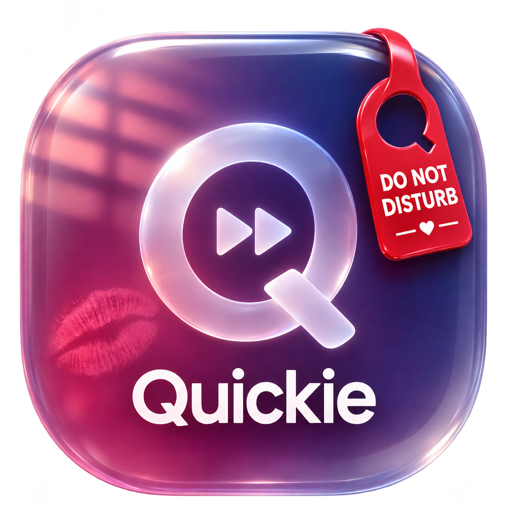

<div align="center">



# Quickie

**Fast. Discreet. Leaves no trace.**

The web, edge to edge; everything else is one keystroke away.
A personal web browser for macOS (Linux later): our own WebKit underneath, a native Rust and AppKit
shell on top.
The page fills the window, the interface answers the keyboard like VS Code, Liquid Glass appears
only where something floats, and nothing phones home.

[](https://github.com/izevg/quickie/actions/workflows/ci.yml)
[](https://github.com/izevg/quickie/releases)
[](LICENSE)
[](Cargo.toml)


</div>

> **Status: pre-alpha.** P0 runs on the system WebKit: tabs, palette, keymap, glass overlays,
> gestures, shields, downloads, and the agent's Ask mode. Next: engine ports and our own WebKit
> fork. See the [roadmap](#roadmap).

## Why

Every browser picks a compromise this one refuses:

- **Arc** proved a browser can be rethought, then sank under its own weight: "bloated", a
  SwiftUI and TCA stack its makers abandoned, tabs lost to sync, and a shutdown on 2026-12-22.
- **Vivaldi** hides its panels behind hover zones that fire when you don't want them and miss
  when you do.
- **Mainstream browsers** ship telemetry, field trials, and search suggestions that send every
  keystroke with a persistent ID.
- **Agentic browsers** let page content steer the agent with your logins attached.

Quickie keeps the good idea (the page is the app, the keyboard is the interface) and drops the
rest. In the idle state you see only the site. Everything else appears on a keystroke, floats on
glass above the page, and is gone when you are done:

```text
┌──────────────────────────────────────────────────────────────┐
│                                                              │
│                 the page, edge to edge                       │
│        no tab bar · no toolbar · no sidebar · no hover       │
│                                                              │
└──────────────────────────────────────────────────────────────┘
                              ⌘⇧P
┌──────────────────────────────────────────────────────────────┐
│          ╭────────────────────────────────────────╮          │
│          │ > reo                                  │          │
│          │   Reopen closed tab            ⌘ ⇧ T   │          │
│          │   Restore last session                 │          │
│          │   > commands · @ headings · ? agent    │          │
│          ╰────────────────────────────────────────╯          │
└──────────────────────────────────────────────────────────────┘
```

## What it does

| Area | What you get | Phase |
|---|---|---|
| Content first | Full-bleed pages; no tab bar, toolbar, or sidebar; nothing revealed on hover | P0 |
| Command palette | `⌘⇧P` for every command, `⌘P` for tabs and history, fuzzy search, frecency, prefixes `>` `@` `#` `?` `!` | P0 |
| Smart tab switching | `⌃⇥` in most-recently-used order: a quick tap flips back, a hold shows thumbnails you can filter by typing | P0 |
| Keymap | VS Code-style bindings with `when` contexts and chords, all rebindable; works on non-Latin layouts | P0 |
| Gestures | Native two-finger back and forward with a live preview, pinch for a tab overview | P0 |
| Liquid Glass with elevation | Four levels (page, indicators, overlays, sheets); glass only where something floats, never glass on glass | P0 |
| Our own WebKit | A WebKit fork built on CI for macOS and Linux (WebKitGTK): automation and request approval for the agent, programmatic Web Inspector, per-request blocking; system codecs | P1 |
| Trackerless | No Google services to strip, built-in ad and tracker blocking, an egress test that proves zero phone-home | P2 |
| Built-in agent | `?` in the palette asks any OpenAI-compatible endpoint (Ollama, LM Studio, hosted APIs) about the page | P4 |
| External agents | MCP over a Unix socket; actions only in an isolated agent profile, with approvals | P4 |
| Anti-fingerprinting | Per-site, per-session noise for canvas, audio, and WebGL | P5 |

### Default keys

All of them are commands in the palette and can be rebound in `keybindings.json` (Settings →
Keys opens it, VS Code's format). ⌘ is Ctrl on Linux: `keybindings.json` writes it `mod`
(`mod+shift+p`), and `⌃⇥` stays Ctrl on both. A shortcut never takes a key that types: a
letter, digit, punctuation key, or the space bar needs ⌘, ⌥ or ⌃ (⇧ alone does not count), so
every text field always gets its characters.

| Keys | Command |
|---|---|
| `⌘⇧P` / `⌘K` | Command palette |
| `⌘P` | Go to tab, bookmark, or history |
| `⌘L` | Address overlay (current URL, site actions) |
| `⌘T` | New tab (opens the address overlay) |
| `⌘⇧N` | New tab in a throwaway jar |
| `⌃⇥` / `⌃⇧⇥` | Next / previous tab in most-recently-used order |
| `⌘1` … `⌘9` | Pinned slots |
| `⌘⌥1` … `⌘⌥9` | Pin the tab to a slot |
| `⌘[` / `⌘]` | Back / forward |
| `⌘R` / `⌘⇧R` | Reload / reload past the cache |
| `⌘=` or `⌘+` / `⌘-` / `⌘0` | Zoom in / out / back to 100 %, remembered per site |
| `⌘⌥P` | Print the page (File → Save Page as PDF, or the palette, saves it to Downloads) |
| `⌘D` | Bookmark the page |
| `⌘F` | Find in page |
| `⌘G` / `⌘⇧G` | Next / previous match |
| `⌥F` / `⇧⌥F` | Link hints; `⇧⌥F` opens the link in a background tab |
| `⌘⇧\` | Tab overview (or pinch in on the page) |
| `⌘⇧C` | Copy the URL |
| `⌘⌥C` | Copy as Markdown link |
| `⌘⇧T` | Reopen the closed tab |
| `⌘W` | Close the tab (it goes to the trash, not away) |
| `⌘J` | Downloads |
| `⌘⌥S` | Shields for the site |
| `⌘N` / `⌘⇧W` | New window / close the window (its tabs go to the trash) |
| `⌃⌘F` | Enter or exit full screen (Window menu, Globe+F, or the window's green button) |
| `⌘.` | Stop the agent's answer (`?` in the palette asks it about the page) |
| `⌘,` | Settings: default browser, downloads, filter lists, the agent, `keybindings.json` |

## Privacy

Trackerless here means a fresh profile opens **zero** connections on its own, and the build proves
it: the egress test starts the browser with a clean profile, records the netlog, and fails on any
host that is not on the allowlist.

| Chrome sends | Quickie |
|---|---|
| Usage metrics, crash reports, field trials | Removed at build time; crash dumps stay on disk |
| Search suggestions with every keystroke | Off |
| Safe Browsing lookups, component updates | Off, or through your own server |
| Sync, Google sign-in, Translate, Privacy Sandbox | Removed |
| Gemini and other AI features | Removed; the built-in agent talks only to the endpoint you configure, only when you ask |

Details, the full checklist, and what breaks: [docs/privacy.md](docs/privacy.md).

## How it is built

```
ui (Feature-Sliced Design) ──▶ application (use cases, port traits) ──▶ domain (pure)
                                     ▲
shell (composition root) ──▶ adapters: WebKit (system, then our fork) · SQLite · LLM · MCP · Keychain
```

- **C++ where it is the engine; Rust everywhere else.** AppKit and Core Animation through `objc2`.
  No Swift, no SwiftUI, no HTML chrome.
- **DDD, hexagonal, clean.** Each bounded context is a crate; the build rejects a wrong-way import.
- **A small WebKit fork.** Our patches as commits on a pinned WebKit revision, rebased for every
  security release, built on CI for macOS and Linux. Chromium is parked
  ([why](docs/architecture.md#decision-our-own-webkit-2026-11-20)).
- **One network stack.** Every request, LLM calls included, goes through the engine, so the egress
  test sees everything.

The whole picture (C1 to C4, crates, hot-path budgets, security): [docs/architecture.md](docs/architecture.md).

## Roadmap

| Phase | Result | Done when |
|---|---|---|
| P0 | The shell on a WebKit stand-in: palette, switcher, glass, gestures, keymap | It works as a daily browser for a week, without extensions |
| P1 | Engine ports; our WebKit fork on CI for macOS and Linux; agent Act mode | The conformance suite passes on the fork; the agent acts with real request approval |
| P2 | Shields, privacy patches, egress test in CI | A fresh profile reaches no unsolicited host in 10 minutes |
| P3 | Settings, keymap editor, environment chips, reader mode | — |
| P4 | Built-in and external agents, approvals, audit log | `?` answers through Ollama; an external agent drives a tab in the agent profile |
| P5 | Anti-fingerprinting, self-hosted services | privacytests.org results on par with Brave |

## Development

Requirements: macOS on Apple Silicon and [mise](https://mise.jdx.dev). Every other tool is pinned
in `.mise.toml` and installed into `~/.local`.

```sh
git clone git@github.com:izevg/quickie.git && cd quickie
mise install && mise trust && mise run setup   # tools and git hooks
mise run pre-commit                            # the fast gates
mise run pre-push                              # everything, mutation testing included
```

Running the development app:

```sh
mise exec -- cargo run -p quickie                  # the bare binary; URLs or files may follow `--`
mise run bundle                                    # target/debug/Quickie.app
mise run bundle --release                          # target/release/Quickie.app
open target/debug/Quickie.app
open -a target/debug/Quickie.app https://example.com page.html
mise run fork                                      # the app on our WebKit fork (needs gh)
```

The development binary runs on the system WebKit. `mise run fork` fetches our fork's build of
the pin (`engine/webkit/scripts/fetch`: sha256, build attestation, the pinned commit), bundles a
debug app that carries it (`cargo xtask bundle --webkit .build/webkit-frameworks`), and runs it.
Releases carry the fork and need macOS 26.5 or later, the macOS it is built for.

`mise run bundle` wraps `cargo xtask bundle`: it builds the shell, lays out `Quickie.app` with its
`Info.plist` (bundle id `dev.quickie.Quickie`, `--bundle-id` for a throwaway build), and an icon
made from `docs/assets/logo.png` at bundle time, and signs it ad hoc so WebKit's helper processes
launch. As a bundle, Quickie opens the links and files other apps hand it, and the palette's
**Set as Default Browser** asks macOS to make it the default browser (macOS confirms with you).
The ad-hoc signature is for this Mac only. A release builds the same bundle with
`--version <X.Y.Z> --dmg`, and `--sign <identity>` signs it with Developer ID under the hardened
runtime for notarization; `release.yml` does all of it and attaches the DMG to the GitHub
Release.

To use Quickie day to day, run the release bundle, `cargo xtask bundle --release` (the same as
`mise run bundle --release`), and open `target/release/Quickie.app`. It is built with fat LTO and
one codegen unit, so it takes minutes to build and is the build whose speed counts. A debug
bundle compiles our crates without optimization and every dependency at `opt-level = 2`
(`[profile.dev.package."*"]`), quick to rebuild and fast enough to try a change.

| Gate | Runs |
|---|---|
| pre-commit | rustfmt, taplo, typos, the rule of four, the layer map, shellcheck, actionlint, secret scan, clippy (pedantic, warnings are errors), tests |
| commit-msg | Conventional Commits, no agent attribution |
| pre-push | all of the above, cargo-deny (no GPL family), unused dependencies, Markdown links, cargo-mutants on domain and application |
| CI | the same tasks on macOS; on pull requests also mutation testing of the changed code |

Work happens on feature branches, squash merged into `release/X.Y.Z`; a release branch is rebase
merged into `main`, where git-cliff computes the version and the release notes from the commits.

## Documentation

| Page | Covers |
|---|---|
| [AGENTS.md](AGENTS.md) | Binding rules for humans and agents: language, commits, branches, the rule of four, layers, invariants, gates |
| [Architecture](docs/architecture.md) | Stack, C1 to C4, crates and ports, Liquid Glass elevation, engine sync, repository layout, infrastructure, roadmap |
| [Quality](docs/quality.md) | Gates, hooks, lints, the layer map, mutation testing, CI and releases |
| [Privacy](docs/privacy.md) | The trackerless model, the services checklist, the egress test |
| [Engine](engine/README.md) | The WebKit fork: its pin, the CI build, and the artifact; the parked Chromium scaffold under `engine/chromium/` |
| [Lessons](docs/lessons.md) | What went wrong in Arc, Dia, Vivaldi, Orion, Zen, Helium, and agentic browsers, and the rule each lesson became |
| [Design system](docs/design/system.md) | Color, type, spacing, elevation, motion, and voice, mapped onto native macOS |
| [Component inventory](docs/design/inventory.md) | Every mocked screen and component, cut into FSD layers |
| [Design ideas](docs/design/ideas.md) | What the mockups proposed, and what we adopt, defer, or reject |
| [Stitch prompt](docs/design/stitch-prompt.md) | The prompt behind the [mockups](docs/design/mocks/) |
| [Releases](https://github.com/izevg/quickie/releases) | Every release, with notes generated from Conventional Commits |

## Contributing

Read [AGENTS.md](AGENTS.md) first. Quickie is built for one person, but the rules hold for anyone,
human or agent: English only, Conventional Commits without agent attribution, the rule of four for
the file tree, the layer map, and the quality gates. Hooks are never bypassed.

## License

[Apache License 2.0](LICENSE). WebKit, which Quickie builds on, keeps its own licenses (WebKit2
BSD; WebCore and JavaScriptCore LGPL-2.1, so our changes to them are published). Every crate must
stay license-compatible (`cargo deny` rejects the GPL family).
