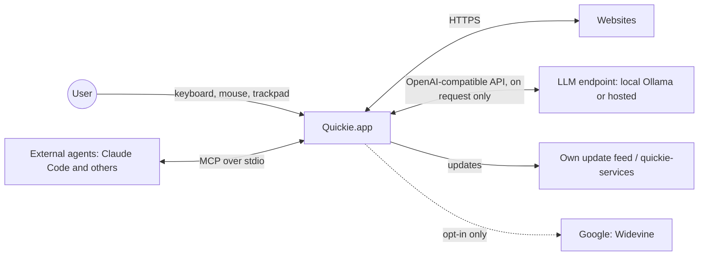

# Architecture

> Status: v0.3 (2026-11-19). Languages: **C++ where it is Chromium; Rust everywhere else.**
> Items marked **[verify]** rest on an unverified source or on inference.

## 0. Principles

1. **Content first.** In the idle state only the page is on screen. UI appears only on an explicit
   key, gesture, or click. Hover-reveal is forbidden.
2. **Native.** AppKit and Core Animation through `objc2`, 120 Hz, the main thread only renders and
   applies cheap mutations.
3. **One build, one repository.** GN builds the product; Cargo builds the shell without Chromium
   for development (P0).
4. **One source of truth per entity**, with explicit engine ↔ domain sync rules (§4.3).
5. **Minimal diff against Chromium**: cheap rebases, a small patch gap.
6. **Trackerless by default, provably** ([privacy.md](privacy.md)).
7. **Never lose a tab**: transactional session mutations, deletion only through the trash.

## 1. Stack

| Layer | Technology | Why |
|---|---|---|
| Engine | Chromium Extended Stable + ungoogled-chromium patches + ours | CDP, DevTools, MV3, compatibility |
| Build | `gn` + `siso` (`autoninja`); Rust in-tree via `rust_static_library`; optional EngFlow remote execution | Rust is first-class in the Chromium tree |
| Chromium boundary | `cxx` (C++ ↔ Rust) plus thin `.mm` files where Chromium's macOS code needs Objective-C++ | No intermediate Objective-C API |
| Shell | Rust 2024, `objc2-app-kit`, `objc2-quartz-core`, `objc2-foundation`, `block2`, `dispatch2` | The same AppKit/CA that Swift would call |
| Liquid Glass | `NSGlassEffectView`/`NSGlassEffectContainerView` (macOS 26), `NSVisualEffectView` fallback (macOS 15) | Through bindings, or `msg_send!` if `objc2-app-kit` lacks the class **[verify]** |
| Shell storage | SQLite (`rusqlite`, linked against the SQLite in the Chromium tree **[verify]**), WAL, FTS5 | Sessions, MRU, palette history, keymap, agent audit |
| Palette | `nucleo-matcher` (fuzzy matcher from Helix, without `nucleo`'s thread pool) + FTS5 + frecency | Fast incremental search |
| Blocker | `adblock` crate (adblock-rust, MPL-2.0) in the network service | Network + cosmetic + scriptlets, no MV2 |
| Built-in agent | Own client for the **OpenAI-compatible API** (`/v1/chat/completions`, SSE, tool calling); HTTP through Chromium's network service | Any endpoint: hosted OpenAI-compatible APIs, Ollama (`127.0.0.1:11434/v1`), LM Studio |
| External agents | MCP via `rmcp` (official Rust SDK) on a Unix socket; CDP only as an internal channel | No TCP port |
| Secrets | Keychain via `security-framework` | LLM API keys never sit in files |
| Updates | Sparkle 2 (Objective-C, called through `objc2`), EdDSA, deltas; Developer ID + notarization | Self-distribution |
| Tests | `cargo test` for pure crates, GN `rust_unit_test`, Chromium `browser_tests` for patches, egress test | See [quality.md](quality.md) |

### Required crates

| Crate | Where | Why |
|---|---|---|
| `objc2`, `objc2-foundation`, `objc2-app-kit`, `objc2-quartz-core`, `block2`, `dispatch2` | ui, adapters | AppKit, Core Animation, GCD |
| `objc2-web-kit` | adapter `engine-webkit` | Engine stand-in for P0 and development |
| `cxx` | adapter `engine-chromium` | Chromium boundary |
| `rusqlite` (+ `fts5`) | adapter `store` | Persistence |
| `nucleo-matcher` | domain `palette` | Fuzzy search |
| `adblock` | engine | Shields |
| `rmcp`, `tokio` (one agent-IO thread only) | adapter `mcp` | MCP server on a Unix socket |
| `serde`, `serde_json`, `thiserror`, `url` | everywhere | |
| `tracing` + a local subscriber | everywhere | Logs go to disk only |
| `security-framework` | adapter `system` | Keychain |
| `indexmap` | domain | MRU stack (ordered set) |

Explicitly **not used**: Swift or SwiftUI, Apple Foundation Models (LLMs only through an
OpenAI-compatible endpoint), a second network stack (`reqwest`/`hyper` for internet traffic: all
traffic goes through Chromium so the netlog and the egress test see it), cloud sync, HTML shells.

Third-party crates are vendored into the Chromium checkout with `gnrt` (Chromium's tool), at
pinned versions, under `.build/` (not tracked).

## 2. C1 — Context



By default the only outbound connections are **the sites the user opens**. The LLM endpoint is
contacted only when the user asks the agent, and only the configured one.

## 3. C2 — Containers

```mermaid
flowchart TB
  subgraph App[Quickie.app — browser process]
    CR[Chromium browser process, C++]
    Glue[//quickie C++ and .mm glue]
    Shell[Rust: UI + application + domain + adapters]
    CR <--> Glue <-->|cxx| Shell
  end
  CR --> R[Renderer helpers]
  CR --> GPU[GPU helper]
  CR --> Net[Network service: adblock, LLM HTTP]
  Shell --> DB[(shell.sqlite)]
  CR --> P[(Chromium profiles: main, agent)]
  MCPB[quickie-mcp: Rust stdio-to-socket bridge] <-->|Unix socket 0600| Shell
  Ext[External agent] <-->|stdio| MCPB
```

- **One browser process, one main thread.** Chromium's UI thread is the macOS main thread, and the
  Rust shell runs on it too (`MainThreadMarker`). Heavy work (ranking, FTS, parsing LLM output)
  runs on the Chromium thread pool (through `cxx`) or on own workers; results return through the
  `dispatch2` main queue.
- **Startup.** The entry point is the stock `ChromeMain`. Our `ChromeBrowserMainExtraParts` calls
  `quickie::shell_start()` through `cxx`. The `BrowserWindow::CreateBrowserWindow` factory is
  replaced through a file override, so the Rust shell creates windows.
- **`NSApplication` is `BrowserCrApplication`** (a Chromium requirement); the shell reaches `NSApp`
  through `objc2`.
- **Two profiles:** `main` (the user) and `agent` (agent actions; no cookies or logins of `main`).
- **Development mode (P0):** the same crates build with Cargo into a standalone app on the
  `engine-webkit` adapter, so UI work never waits for a Chromium build.

## 4. C3 — Components

### 4.1 Layers (DDD + hexagonal + clean) as crates

```
ui (FSD) ──▶ application (use cases, port traits) ──▶ domain (pure)
                  ▲
shell (composition root) ──▶ adapters (engine-chromium | engine-webkit, store, llm, mcp, system, updater)
```

The dependency rule points inward and is enforced by the build and by `cargo xtask layers`
([quality.md](quality.md)). Domain crates use only `std`, `thiserror`, `indexmap`,
`nucleo-matcher`, `serde`, `url`: no `objc2`, `cxx`, or `rusqlite`.

**Bounded contexts** (`crates/domain/<name>`, package `quickie-domain-<name>`). Contexts depend on
the kernel only; cross-context work is a use case. Eight directories is the rule-of-four limit: a
ninth context means regrouping first.

| Crate | Aggregates / value objects | Invariants |
|---|---|---|
| `kernel` | IDs (`TabId`, `WindowId`, `CommandId`, ...), `Timestamp`, shared value types | — |
| `browsing` | `Window`, `Tab` (id, engine ref, pinned slot, last active), `MruStack`, `ClosedTabTrash` | MRU updates synchronously on activation; a closed tab stays 30 days in the trash |
| `commands` | `Command`, `Keymap`, `KeyBinding` (chord, `when`), `WhenExpr`, `KeyStroke` (key code + ASCII) | Browser-reserved shortcuts never reach the page; a binding conflict is a validation error |
| `palette` | `Query` (prefixes `>` `@` `#` `?` `!`), `Candidate`, `Frecency` | First batch within 16 ms, then streaming |
| `library` | `HistoryEntry`, `Download` | Local only |
| `shields` | `SitePolicy`, `FilterListSet`, `FingerprintPolicy` | Per-site exceptions; lists only from allowed sources |
| `agents` | `AgentSession` (built-in or external), `Mode` (Ask or Act), `ToolCall`, `CapabilityGrant`, `PendingAction`, `ProvenanceSet`, `LlmEndpoint` (base URL, model, key ref) | **Ask** only reads the current page of `main`, on an explicit request. **Act** only in the agent profile, URLs only from provenance, irreversible actions only after approval |
| `settings` | `Preferences` | — |

**Ports** (`crates/application`), all traits:

| Port | Direction | Adapter |
|---|---|---|
| `EnginePort` + `EngineEvents` | driven | `engine-chromium` (cxx), `engine-webkit` (development) |
| `HttpPort` | driven | Chromium network service (product), `NSURLSession` (development) |
| `LlmPort` | driven | `llm`: OpenAI-compatible client on top of `HttpPort` |
| `SessionRepo`, `HistoryRepo`, `KeymapRepo`, `AuditLog` | driven | `store` (rusqlite) |
| `ShieldsPort` | driven | engine |
| `SecretStore`, `Clipboard`, `GlobalHotkey`, `KeyboardLayout`, `Updater` | driven | `system` (Keychain, `NSPasteboard`, Carbon `RegisterEventHotKey`, `TISCopyCurrentASCIICapableKeyboardLayoutInputSource`), `updater` (Sparkle) |
| `AgentGateway` | driving | `mcp` (rmcp on a Unix socket) |
| UI intents | driving | `ui/features` call use cases |

### 4.2 UI: Feature-Sliced Design as crates

| FSD layer (`crates/ui/...`) | Contents | Depends on |
|---|---|---|
| `app` | Window composition, overlay router (one active E2 at a time), theme, tokens | everything below |
| `screens` | `BrowserScreen`, `SettingsScreen`, `KeymapEditorScreen`, `AgentAuditScreen` | widgets and below |
| `widgets` | `CommandPalette`, `AddressOverlay`, `TabSwitcher`, `TabOverview`, `FindBar`, `LinkHintsLayer`, `ToastStack`, `LoadProgressLine`, `OriginChip`, `PermissionSheet`, `ShieldsPopover`, `DownloadsPopover`, `AgentAnswerPanel`, `AgentApprovalSheet` | features and below |
| `features` | `copy_url`, `copy_as_markdown`, `reopen_closed_tab`, `find_in_page`, `toggle_shields`, `ask_agent`, `approve_agent_action`, `record_shortcut`, `swipe_navigation`, `link_hints` | entities and below, application |
| `entities` | `TabRow`, `TabThumbnail`, `CommandRow`, `HistoryRow`, `KeycapGroup`, `AgentBadge`, `OriginLabel` | shared, domain |
| `shared` | `GlassSurface::new(Elevation)`, `ListView` (`NSTableView` with a diffing source), `Keycap`, spring presets (`CASpringAnimation`), colors, typography | `objc2` |

The full, mockup-backed list with states is the [component inventory](design/inventory.md); the
tokens are in the [design system](design/system.md).

Rules: slices of one layer never use each other; business logic lives only in domain and
application; lists are only `NSTableView`/`NSCollectionView`; custom views use `define_class!`,
and private AppKit methods are never overridden.

**Liquid Glass elevation:**

| Level | What | Material | Shadow | Content dimming |
|---|---|---|---|---|
| E0 | Web content | none | — | — |
| E1 | Progress line, toasts, `OriginChip`, `AgentBadge` | glass `.clear` | none | none |
| E2 | Palette, address, switcher, overview, find, popovers, `AgentAnswerPanel` | glass `.regular` inside `NSGlassEffectContainerView` | medium | 8–12 % |
| E3 | Permission, approval, auth sheets | glass `.regular` + tint | deep | 25–35 % |

Forbidden: glass on glass (an E3 collapses the E2 under it); glass in the content layer; two E2
overlays at once.

### 4.3 Engine ↔ domain sync

- **Chromium's `TabStripModel`** is the truth about live tabs (needed by `chrome.tabs` and
  `window.open`).
- **`browsing`** is the truth about organization and persistence (MRU, slots, trash, restore).
- Commands: UI → use case → `EnginePort`. Engine events (a site or an extension opened a tab) →
  adapter → `ReconcileTab` → domain. There are no silent reverse mutations.
- Each tab's navigation state (`SessionState`, Chromium's serialization) is stored in
  `shell.sqlite`; Chromium's own session restore is off.

### 4.4 Engine (`engine/quickie`, built as `//quickie` in the tree)

| Component | Language | Role |
|---|---|---|
| `bridge/` | C++ + `cxx` | C++ ↔ Rust boundary: create, close, restore tabs; events; snapshots |
| `browser_window/` | Objective-C++ | `BrowserWindow` without Views' `BrowserView`: the WebContents view (`RenderWidgetHostViewCocoa`) is embedded into an `NSView` the shell provides |
| `keyboard/` | Objective-C++ | Key equivalents: reserved ones go to Rust before the renderer; the rest go to the page first |
| `swipe/` | Objective-C++ | Hooks `HistorySwiper` and forwards events to Rust for the native preview |
| `shields/` | C++ + Rust | `adblock` in a `URLLoaderThrottle`, cosmetic filtering, CNAME uncloaking through the built-in resolver |
| `net_bridge/` | C++ + `cxx` | `HttpPort` on `SimpleURLLoader` with streaming (LLM SSE) |
| `privacy/` | C++ patches | On top of ungoogled-chromium ([privacy.md](privacy.md)) |
| `agent_bridge/` | C++ | Internal DevTools session (`DevToolsAgentHost`), agent profile only, no port |

Inherited Views surfaces (permission bubbles, extension popups, autofill) stay in v1 as separate
windows anchored to a point; permissions and the fullscreen notice become native E3 sheets in P3.

## 5. C4 — Code

```rust
// crates/application/src/ports.rs
pub trait EnginePort {
    fn create_tab(&self, w: WindowId, url: &Url, p: ProfileKind) -> TabRef;
    fn activate(&self, t: TabRef);
    fn close(&self, t: TabRef) -> SessionState;              // goes to the trash
    fn restore(&self, s: &SessionState, w: WindowId) -> TabRef;
    fn snapshot(&self, t: TabRef, done: Box<dyn FnOnce(Option<Image>)>);
    fn page_text(&self, t: TabRef, done: Box<dyn FnOnce(Result<PageDigest, EngineError>)>); // Ask mode
    fn execute(&self, t: TabRef, c: EngineCommand);           // back, reload, find, zoom, ...
}

pub trait LlmPort {
    /// OpenAI-compatible /v1/chat/completions, stream = true, tools = ...
    fn chat(&self, ep: &LlmEndpoint, req: ChatRequest, sink: Box<dyn ChatSink>) -> CancelHandle;
}
```

```rust
// crates/domain/browsing/src/mru.rs: a pure type, no allocation on the hot path
pub struct MruStack(indexmap::IndexSet<TabId>);
impl MruStack {
    pub fn touch(&mut self, id: TabId) { self.0.shift_remove(&id); self.0.insert_before(0, id); }
    pub fn nth(&self, i: usize) -> Option<TabId> { self.0.get_index(i).copied() }
}

// crates/domain/commands/src/keystroke.rs
pub struct KeyStroke { pub key_code: u16, pub ascii: char, pub mods: Mods }
// `ascii` comes from the ASCII-capable layout, so ⌘⇧C works on a Russian layout.
```

```rust
// engine/quickie/bridge/lib.rs
#[cxx::bridge(namespace = "quickie")]
mod ffi {
    extern "Rust" {
        type Shell;
        fn shell_start() -> Box<Shell>;
        fn host_view_for_window(self: &Shell, window: u64) -> usize;          // NSView*
        fn handle_key_equivalent(self: &mut Shell, key_code: u16, mods: u32, ascii: u32) -> bool;
        fn on_engine_event(self: &mut Shell, ev: &EngineEvent);
    }
    unsafe extern "C++" {
        include!("quickie/bridge/engine.h");
        fn create_tab(window: u64, url: &str, profile: u8) -> u64;
        fn close_tab(tab: u64) -> Vec<u8>;                                    // SessionState
        fn restore_tab(window: u64, state: &[u8]) -> u64;
    }
}
```

Hot-path budgets:

| Path | Budget | How |
|---|---|---|
| Ctrl+Tab → switch | ≤ 1 frame | MRU in memory; the overlay appears only after a hold > 150 ms |
| Open the palette | ≤ 16 ms to first frame | Prewarmed window; first batch from the in-memory MRU, FTS fills in |
| Swipe back | 120 Hz | Cached snapshot, animation on a `CALayer` |
| First agent token | ≤ endpoint TTFT + 20 ms | SSE streams straight into `AgentAnswerPanel` |
| Cold start to first frame | ≤ 300 ms **[target]** | Lazy restore; background tabs discarded |

## 6. Repository layout

Follows the rule of four ([AGENTS.md](../AGENTS.md)).

```
quickie/
├─ AGENTS.md  CLAUDE.md  README.md  Cargo.toml  Cargo.lock
├─ docs/         architecture.md  lessons.md  privacy.md  quality.md  design/
├─ crates/
│  ├─ domain/       kernel  browsing  commands  palette  library  shields  agents  settings
│  ├─ application/  use cases + port traits
│  ├─ adapters/     engine-chromium (GN only)  engine-webkit (dev)  store  llm  mcp  system  updater
│  ├─ ui/           shared  entities  features  widgets  screens  app
│  └─ shell/        composition root; also the dev binary on engine-webkit
├─ engine/
│  ├─ chromium.pin      Chromium version (Extended Stable) + ungoogled-chromium revision
│  ├─ gclient.template
│  ├─ patches/          our patches only, grouped by meaning (series + one directory per area)
│  ├─ overrides/        Chromium file overrides instead of patches (BrowserWindow factory, ...)
│  ├─ quickie/          //quickie: bridge, browser_window, keyboard, swipe, shields, net_bridge, privacy, agent_bridge
│  └─ scripts/          sync, apply, rebase, build, sign, notarize (+ gn args)
├─ tools/
│  ├─ xtask/          structure, layer and commit-message checks
│  ├─ quickie-mcp/    stdio-to-socket bridge for external agents
│  ├─ egress-test/    fresh profile + netlog + allowlist diff
│  └─ rebase-bot/     scripts and prompts for agent-assisted rebases
└─ services/          optional, self-hosted: update-feed, filter-mirror, component-proxy
```

Not tracked, under `.build/`: the Chromium checkout, the fetched ungoogled-chromium patch series,
vendored crates, build output.

## 7. Infrastructure

| Node | Needed | Description |
|---|---|---|
| Build machine | yes | Apple Silicon, ≥ 64 GB RAM, ≥ 1 TB SSD (tree + out ≈ 150+ GB), APFS, a path without spaces, current Xcode/SDK |
| Remote execution | optional | EngFlow (Siso remote execution on macOS since M145) **[verify pricing]** |
| CI | yes | Self-hosted runner: the [quality.md](quality.md) gates → GN build → `browser_tests` → egress test → sign → notarize |
| Rebase bot | yes | Every 8 weeks (Extended Stable) and on every security release; an agent fixes conflicts, a human reviews |
| Update feed | yes | Static Sparkle appcast |
| quickie-services | optional | Component proxy, filter-list mirror, CRX proxy (the Helium / Brave `go-update` pattern) |
| LLM | optional | Local Ollama/LM Studio or any OpenAI-compatible endpoint; key in the Keychain |
| Crash | local | Crashpad writes dumps to disk only |
| Patch-gap metric | yes | Target ≤ 72 h from a Chromium security fix to our release |

## 8. Security

- **Spoofing with hidden chrome:** `OriginChip` on every origin change; a persistent origin chip on
  pages with password fields; site-requested fullscreen always shows a notice; a popup without a
  URL shows `about:blank` (lessons from Dia's 2025 CVEs).
- No server-side content that executes code (Arc Boosts, CVE-2024-45489).
- **Built-in agent:** page content goes to the LLM as untrusted data, separate from the user's
  instructions. Ask mode only reads, and only on an explicit `?`. Act mode runs only in the agent
  profile, with the provenance rule and approvals. Palette input without `?` never reaches an LLM.
- **External agents:** MCP only over a `0600` Unix socket, tools on an allowlist, the same Act
  rules, a full audit log in `shell.sqlite`.
- Hardened Runtime, minimal entitlements per helper (JIT only for renderer and GPU), Sparkle only
  with EdDSA.

## 9. Roadmap

| Phase | Result | Done when |
|---|---|---|
| P0 | Cargo-built app on `engine-webkit`: palette, MRU switcher, glass E0–E3, swipes, keymap | I live in it for a week as my main browser (without extensions) |
| P1 | Chromium + ungoogled patches + `//quickie` + `BrowserWindow` host + `cxx` bridge | The same UI on Chromium, DevTools, MV3 |
| P2 | Shields + privacy patches + egress test in CI | A fresh profile: zero unsolicited hosts in 10 minutes |
| P3 | Native E3 sheets instead of Views bubbles, link hints, tab overview, keymap editor | — |
| P4 | Agents: built-in (OpenAI-compatible, Ask then Act), MCP for external ones, approvals, audit | `?` in the palette answers through Ollama; Claude Code drives a tab in the agent profile |
| P5 | Anti-fingerprinting, quickie-services | privacytests.org results on par with Brave **[target]** |
