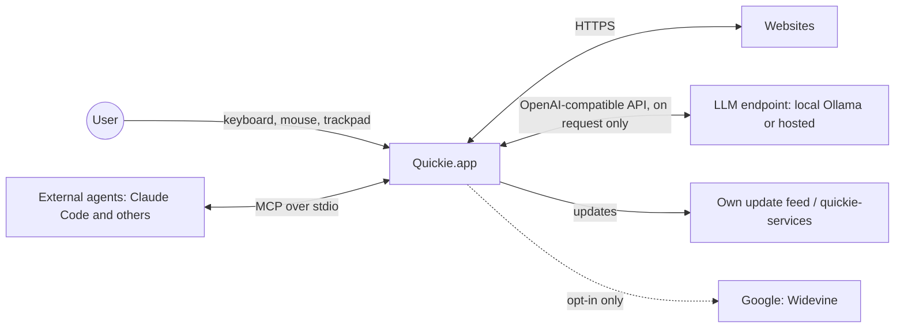

# Architecture

> Status: v0.4 (2026-11-20). Languages: **C++ where it is the engine; Rust everywhere else.**
> Items marked **[verify]** rest on an unverified source or on inference.
>
> **Engine decision (2026-11-20): our own WebKit, not Chromium.** See "Decision: our own WebKit" in
> §4.1. Sections that still describe the Chromium build (§1 rows Engine/Build/boundary, §3, §4.3,
> §4.4, §7) describe the parked Chromium path; they are rewritten as the WebKit fork lands (§6
> already shows `engine/webkit/`), and the Chromium scaffold stays under `engine/chromium/` as
> reference until then.

## 0. Principles

1. **Content first.** In the idle state only the page is on screen, edge to edge, with the
   system's window buttons floating over its top-left corner. UI appears only on an explicit
   key, gesture, or click. Hover-reveal is forbidden.
2. **Native.** AppKit and Core Animation through `objc2`, 120 Hz, the main thread only renders and
   applies cheap mutations.
3. **One build, one repository.** GN builds the product; Cargo builds the shell without Chromium
   for development (P0).
4. **One source of truth per entity**, with explicit engine ↔ domain sync rules (§4.3).
5. **Minimal diff against Chromium**: cheap rebases, a small patch gap.
6. **Trackerless by default, provably** ([privacy.md](privacy.md)).
7. **Never lose a tab**: transactional session mutations, deletion only through the trash.

## 1. Stack

| Layer | Technology | Why |
|---|---|---|
| Engine | **Our WebKit fork** (macOS: WebKit; Linux: WebKitGTK from the same tree) with our patches; the system `WKWebView` until the fork ships | Lighter than Chromium to build and run, system codecs, Playwright-style automation by patch. Chromium below is the parked path |
| Engine (parked) | Chromium Extended Stable + ungoogled-chromium patches + ours | CDP, DevTools, MV3, compatibility |
| Build | `gn` + `siso` (`autoninja`); Rust in-tree via `rust_static_library`; optional EngFlow remote execution | Rust is first-class in the Chromium tree |
| Chromium boundary | `cxx` (C++ ↔ Rust) plus thin `.mm` files where Chromium's macOS code needs Objective-C++ | No intermediate Objective-C API |
| Shell | Rust 2024, `objc2-app-kit`, `objc2-quartz-core`, `objc2-foundation`, `block2`, `dispatch2` | The same AppKit/CA that Swift would call |
| Liquid Glass | `NSGlassEffectView`/`NSGlassEffectContainerView` (macOS 26), `NSVisualEffectView` fallback (macOS 15) | Through bindings, or `msg_send!` if `objc2-app-kit` lacks the class **[verify]** |
| Shell storage | SQLite (`rusqlite`, linked against the SQLite in the Chromium tree **[verify]**), WAL, FTS5 | Sessions, MRU, palette history, keymap, agent audit |
| Palette | `nucleo-matcher` (fuzzy matcher from Helix, without `nucleo`'s thread pool) + FTS5 + frecency | Fast incremental search |
| Blocker | `adblock` crate (adblock-rust, MPL-2.0) in the network service | Network + cosmetic + scriptlets, no MV2 |
| Built-in agent | Own client for the **OpenAI-compatible API** (`/v1/chat/completions`, SSE, tool calling); HTTP through Chromium's network service | Any endpoint: hosted OpenAI-compatible APIs, Ollama (`127.0.0.1:11434/v1`), LM Studio |
| External agents | MCP via `rmcp` (official Rust SDK) on a Unix socket; CDP only as an internal channel | No TCP port |
| Secrets | Keychain via `security-framework` | LLM API keys never sit in files |
| Updates | Sparkle 2 (Objective-C, called through `objc2`), EdDSA, deltas; Developer ID + notarization | Self-distribution |
| Tests | `cargo test` for pure crates, GN `rust_unit_test`, Chromium `browser_tests` for patches, egress test | See [quality.md](quality.md) |

### Required crates

| Crate | Where | Why |
|---|---|---|
| `objc2`, `objc2-foundation`, `objc2-app-kit`, `objc2-quartz-core`, `block2`, `dispatch2` | ui, adapters | AppKit, Core Animation, GCD |
| `objc2-web-kit` | adapter `engine-webkit` | Engine stand-in for P0 and development |
| `cxx` | adapter `engine-chromium` | Chromium boundary |
| `rusqlite` (+ `fts5`) | adapter `store` | Persistence |
| `nucleo-matcher` | domain `palette` | Fuzzy search |
| `adblock` | engine | Shields |
| `rmcp`, `tokio` (one agent-IO thread only) | adapter `mcp` | MCP server on a Unix socket |
| `serde`, `serde_json`, `thiserror`, `url` | everywhere | |
| `tracing` + a local subscriber | everywhere | Logs go to disk only |
| `security-framework` | adapter `system` | Keychain |
| `indexmap` | domain | MRU stack (ordered set) |

Explicitly **not used**: Swift or SwiftUI, Apple Foundation Models (LLMs only through an
OpenAI-compatible endpoint), a second network stack (`reqwest`/`hyper` for internet traffic: all
traffic goes through Chromium so the netlog and the egress test see it), cloud sync, HTML shells.

Third-party crates are vendored into the Chromium checkout with `gnrt` (Chromium's tool), at
pinned versions, under `.build/` (not tracked).

## 2. C1 — Context



By default the only outbound connections are **the sites the user opens**. The LLM endpoint is
contacted only when the user asks the agent, and only the configured one.

## 3. C2 — Containers

```mermaid
flowchart TB
  subgraph App[Quickie.app — browser process]
    CR[Chromium browser process, C++]
    Glue[//quickie C++ and .mm glue]
    Shell[Rust: UI + application + domain + adapters]
    CR <--> Glue <-->|cxx| Shell
  end
  CR --> R[Renderer helpers]
  CR --> GPU[GPU helper]
  CR --> Net[Network service: adblock, LLM HTTP]
  Shell --> DB[(shell.sqlite)]
  CR --> P[(Chromium profiles: main, agent)]
  MCPB[quickie-mcp: Rust stdio-to-socket bridge] <-->|Unix socket 0600| Shell
  Ext[External agent] <-->|stdio| MCPB
```

- **One browser process, one main thread.** Chromium's UI thread is the macOS main thread, and the
  Rust shell runs on it too (`MainThreadMarker`). Heavy work (ranking, FTS, parsing LLM output)
  runs on the Chromium thread pool (through `cxx`) or on own workers; results return through the
  `dispatch2` main queue.
- **Startup.** The entry point is the stock `ChromeMain`. Our `ChromeBrowserMainExtraParts` calls
  `quickie::shell_start()` through `cxx`. The `BrowserWindow::CreateBrowserWindow` factory is
  replaced through a file override, so the Rust shell creates windows.
- **`NSApplication` is `BrowserCrApplication`** (a Chromium requirement); the shell reaches `NSApp`
  through `objc2`.
- **Two profiles:** `main` (the user) and `agent` (agent actions; no cookies or logins of `main`).
- **Development mode (P0):** the same crates build with Cargo into a standalone app on the
  `engine-webkit` adapter, so UI work never waits for a Chromium build. `cargo xtask bundle`
  (`mise run bundle`) wraps it as an ad-hoc signed `Quickie.app` that LaunchServices registers as
  a browser; signing with a Developer ID and notarizing come with the product build (§7, P1).

## 4. C3 — Components

### 4.1 Layers (DDD + hexagonal + clean) as crates

```
ui (FSD) ──▶ application (use cases, port traits) ──▶ domain (pure)
                  ▲
shell (composition root) ──▶ adapters (engine-chromium | engine-webkit, store, llm, mcp, system, updater)
```

The dependency rule points inward and is enforced by the build and by `cargo xtask layers`
([quality.md](quality.md)). Domain crates use only `std`, `thiserror`, `indexmap`,
`nucleo-matcher`, `serde`, `url`: no `objc2`, `cxx`, or `rusqlite`.

**Bounded contexts** (`crates/domain/<name>`, package `quickie-domain-<name>`). Contexts depend on
the kernel only; cross-context work is a use case. Eight directories is the rule-of-four limit: a
ninth context means regrouping first.

| Crate | Aggregates / value objects | Invariants |
|---|---|---|
| `kernel` | IDs (`TabId`, `WindowId`, `CommandId`, ...), `Timestamp`, `Site`, shared value types | — |
| `browsing` | `Window`, `Tab` (id, engine ref, pinned slot, last active), `MruStack`, `ClosedTabTrash` | MRU updates synchronously on activation; a closed tab stays 30 days in the trash |
| `commands` | `Command`, `Keymap`, `KeyBinding` (chord, `when`), `WhenExpr`, `KeyStroke` (key code + ASCII) | Browser-reserved shortcuts never reach the page; a binding conflict is a validation error |
| `palette` | `Query` (prefixes `>` `@` `#` `?` `!`), `Candidate` (text kept in `Texts`), `Frecency`, `Ranker` | Candidates are gathered, cut into characters, and scored once when the palette opens; a keystroke only ranks. First batch within 16 ms, then streaming |
| `library` | `History` of `HistoryEntry`, `Download` | Local only. History keeps at most `HISTORY_CAP` (100 000) pages, pushing out the page visited longest ago; it is ordered by a last-visit number that only grows, and a visit saves its own entry, never the table |
| `shields` | `SitePolicy`, `FilterListSet`, `FingerprintPolicy` | Per-site exceptions; lists only from allowed sources |
| `agents` | `AgentSession` (built-in or external), `Mode` (Ask or Act), `ToolCall`, `CapabilityGrant`, `PendingAction`, `ProvenanceSet`, `LlmEndpoint` (base URL, model, key ref) | **Ask** only reads the current page of `main`, on an explicit request. **Act** only in the agent profile, URLs only from provenance, irreversible actions only after approval |
| `settings` | `Preferences`; `SiteZooms` with `ZoomLevel` (Safari's steps, 50 % to 300 %); `InstalledExtensions` (`ExtensionId`, `ExtensionVersion`, `Grants`, `SiteAccess`) | A site at 100 % is not listed; a throwaway jar's zoom is never saved; an extension is listed only once the user approved what it asks for; updates on their own only when the user lets them, once a day |

**Ports** (`crates/application`), all traits:

| Port | Direction | Adapter |
|---|---|---|
| `Engine` bundle: `EnginePort` (tab lifecycle) + capability ports `PageSurface`, `PageContent`, `PageZoom`, `PageAsks`, `Downloads`, `PageVideo`, and for the agent profile `Automation`, `RequestGate`; one `EngineEvent` stream | driven | `engine-webkit`, `engine-cef` (agent profile), `engine-chromium` (post-MVP fork); see "Engines" below |
| `HttpPort` | driven | supplied by the engine (`Engine::Http`): Chromium or CEF network stack, `NSURLSession` on WebKit; the shell never builds one |
| `ExtensionHost` (capability), `ExtensionPackages` | driven | supplied by the engine (`Engine::Extensions`; `NoExtensions` on one without them): `engine-webkit` (`WKWebExtensionController`, main profile only); `system` checks CRX3 signatures with Security.framework and keeps packages |
| `ExtensionsRepo` | driven | `store` |
| `LlmPort` | driven | `llm`: OpenAI-compatible client on top of `HttpPort` |
| `SessionRepo`, `LibraryRepo`, `KeymapRepo`, `ShieldsRepo`, `AuditLog` | driven | `store` (rusqlite; saves go to a write-behind thread off the main thread) |
| `ContentBlockerPort` | driven | supplied by the engine (`Engine::Blocker`): `adblock` in the network service (product), `WKContentRuleList` (development); reports a `RulesStatus` (idle, compiling, active, failed) and wakes the shell when rules settle |
| `SecretStore`, `Entropy`, `Updater` | driven | `system` (Keychain, `SecRandom`), `updater` (Sparkle) |
| Clipboard, reveal in Finder, default browser, global hotkey, keyboard layout | — | Not ports until a use case calls them: today only the shell does, and a Linux shell writes its own glue |
| `AgentGateway` | driving | `mcp` (rmcp on a Unix socket) |
| UI intents | driving | `ui/features` call use cases |

#### Portability

Quickie ships on macOS; a Linux port (never Windows) must be an addition, not a rewrite, and must
cost nothing at run time.

- **The platform is chosen once, at the composition root.** The shell passes a plain value
  (`quickie_domain_commands::Platform`) into the use cases that need it; nothing downstream asks
  which platform it runs on, and there is no `cfg`, no dynamic dispatch, and no platform check on
  a hot path.
- **Domain, application, `store`, and `llm` are platform-free.** They take the platform as data
  where conventions differ (the keymap) and never reach for platform APIs.
- **Platform code lives in adapters, `ui`, and `shell` only.** A Linux port adds its own shell,
  UI crates, and system adapters next to the macOS ones.
- **The engine is chosen the same way.** A cargo feature of the shell picks it, and one alias at
  the root names it; the shell is generic over the engine ports only (see "Engines" below).
- **Keys are written once.** Default bindings use `mod` for the primary modifier (`⌘` on macOS,
  Ctrl on Linux), resolved when the keymap is built, so a key stroke is always concrete and the
  lookup costs the same everywhere. Reserved strokes and conflicts follow from the resolved keys;
  keycaps print per platform (`⇧⌘P`, `Ctrl+Shift+P`).
- **Keys reach the shell first, and only what it binds stops there.** On macOS the app's local
  event monitor sees every key press before the menu bar's key equivalents, the first responder
  (the page, a field, an overlay), and `AppKit`. In order: a press held with `fn`/Globe on a key
  that does not carry `fn` by itself is the system's and passes untouched (Globe+F, Globe+⌃F);
  a press the page did not take comes back from `WebKit` through the monitor and passes again
  untouched; a press in another window (Settings, a system panel) is that window's, except
  `⌘W`/`⌘,` in Settings and `⌘Q`; then an open `⌃⇥` cycle takes `⎋` (and, once its switcher
  shows, the letters that filter it and `W`, which closes the selected tab), a sheet its keys,
  the overview and link hints theirs, an overlay its fixed keys, and the keymap resolves the
  rest in the current `when` context. A letter is the Latin letter the layout types (QWERTZ's `⌘Z`
  is undo), else its US key position (a Russian `д` on the `L` key is `⌘L`). What the keymap
  does not bind goes on to the page, the field, and the menu bar (`⌘C`, `⌘H`, `⌘M`, `⌃⌘F`).
  State between presses never outlives the user's attention: a chord's first stroke waits 2 s
  at most and is dropped by a click, a window or the app losing the keyboard, or a full-screen
  transition, which also end a held `⌃⇥` cycle; `inputFocused` counts only while the page has
  the keyboard. "Show Key Debug Overlay" in the palette lists the last presses and what became
  of each.

#### Engines: ports, capabilities, profiles

Engines are swapped by changing one type alias, never by editing call sites. Decided 2026-11-20;
the audit behind it found ~45 shell call sites tied to `WebKitEngine` and four places where the
browser's own traffic bypassed the engine's network stack.

- **Ports name outcomes, not mechanisms.** `EnginePort` keeps the tab lifecycle (create, show,
  navigate, close, adopt, destroy a jar). Small capability ports sit next to it in
  `application/src/engine/`: `PageSurface` (the native view and thumbnails), `PageContent` (page
  text, link-hint targets, find), `PageZoom`, `PageAsks` (JavaScript dialogs, permissions, full
  screen, answered with a `ReplyToken`), `Downloads`, `PageVideo` (the mini player: a left
  tab's page floats into a slot showing only its video, docks back, plays or pauses; on the
  system WebKit the `WKWebView` itself moves and a script in Quickie's world makes its video
  fill it). There is no "evaluate JavaScript" port: an isolated world is how WebKit does it, not
  what a use case needs.
- **One event stream.** Every engine reports through one `EngineEvent` enum, drained by the shell
  on the main thread after a waker. Nothing calls back into a use case from inside an engine
  call.
- **The engine is a bundle.** `trait Engine` names the associated types the shell embeds or
  forwards (`View`, `Picture`, `Page`), supplies the network stack (`Http`), the content
  blocker (`Blocker`), and the web extension host (`Extensions`), and declares `CAPS`, a `const` of what the UI may offer (programmatic inspector, blocked
  counts, ...). A capability a use case cannot work without is a trait bound, so a missing one is
  a compile error; a capability the UI merely degrades without is checked against `CAPS`, also at
  compile time. Nothing is decided at run time.
- **Policy lives in use cases.** Download ids, zoom on commit, automatic answers to dialogs and
  permissions, and collecting page text for the agent are application code driving the ports,
  tested against the in-memory fake; the shell only routes.
- **Web extensions are a capability.** `CAPS.web_extensions` (`Capabilities` in
  `application/src/engine/`) says an engine runs them; the `Extensions` use case needs an
  `ExtensionHost`, which reports through its own `ExtensionEvent` stream (a package read, a
  permission asked, a popup, a tab to open, activate, or close) and is told the windows and
  tabs (`arrange`). On the system WebKit it is one `WKWebExtensionController` for the main
  profile, attached to every main-jar page; WebKit types stay in the adapter, and the shell
  sees only the popup's view. Store installs and updates follow the Chrome Web Store's update
  protocol through `HttpPort`, only on request ([privacy.md](privacy.md)).
- **An engine per profile.** Tab and window ids carry their `Profile` (`Main`, `Agent`), and each
  profile has its own session, so a tab never moves between engines and ids never collide. The
  agent profile's tabs are never persisted: the agent leaves an audit log, not tabs. The shell
  meets two engines in exactly one place, a two-arm `match` on the profile; each arm is statically
  typed. No `dyn Engine`, no `enum AnyEngine`.
- **Act mode is two ports.** `Automation` (read the DOM and the accessibility tree, trusted input,
  navigate) is implemented on WebKit with scripts in an isolated world and synthetic `NSEvent`s,
  and on our WebKit fork with a Playwright-style protocol patch, inside the process. `RequestGate`
  (hold a request, show its payload, let it go) only exists where such a protocol does: on the
  fork, not on the system WebKit. The Act use
  case requires `Automation`; with `RequestGate` it approves the real request, without it it asks
  before the DOM action (form submit, a destructive button) and says that it cannot see the
  request. Both follow the shape of Playwright's WebKit protocol (`Input`, `Network` interception,
  `Page`), so the system-WebKit stopgap and the fork expose the same port.
- **Engine choice is a cargo feature at the composition root**: one alias per profile. The shell's
  `main-webkit` (default) and `main-chromium` features pick `MainEngine` in
  `crates/shell/src/main.rs`, and `compile_error!` refuses both or neither; no `cfg` exists
  below the root. Use cases hand their adapters out only through ports (`Browsing::engine` is
  `impl PortsOf<E>`, `Shields::blocker_mut` and `Extensions::host` likewise), so an adapter's own
  methods are out of the shell's reach. CI lints the shell with `main-chromium` too
  (`mise run engine-swap`; the parked engine compiles without its bridge and refuses every
  call), so a WebKit name or a call only one engine supports breaks the build instead of a
  release.
- **One conformance suite.** `application` ships behavioral tests (feature `conformance`) that
  every engine adapter runs, with the fake as the reference: navigation, opened pages, dialogs,
  find, link hints, jars, downloads, the content blocker, and on the fork automation and renderer
  crashes. Pixels, print panels, the inspector and real focus stay with the harness.

#### Decision: our own WebKit (2026-11-20)

**Quickie's engine is a fork of WebKit that we patch and build ourselves, on macOS and on Linux.**
Until the fork ships, both profiles run on the system `WKWebView` through `engine-webkit`; then
both profiles move to the fork. Chromium and CEF are parked.

Why:
- **It fits the hardware and the team.** A WebKit build is about a third of Chromium's (~50 GB,
  1–2 h on Apple Silicon **[verify on our CI]**); a Chromium fork needs a 64 GB machine and a
  night per security update.
- **The gaps that made Chromium attractive are patchable.** Playwright's open WebKit patches add
  a protocol with trusted input, request interception, isolated contexts and screencasting; we
  take the same approach for `Automation` and `RequestGate`, a programmatic inspector, per-request
  blocking with counts, and anything else the ports need.
- **What WebKit already does well stays:** system media codecs (H.264, AAC, HEVC through
  AVFoundation / GStreamer), power and memory use, no Google services to strip.
- **One engine, both profiles.** `main` and `agent` run on the same fork, so there are never two
  WebKits in one process and `RequestGate` is available to the agent from the fork's first
  release. Until then the agent's `Automation` runs on the system WebKit with scripts in an
  isolated world and synthetic input, without `RequestGate`.

What we accept:
- **We own security updates.** The system WebKit updates with macOS; the fork does not. We track
  WebKit security releases (Apple security notes, WebKitGTK/WPE security advisories) and ship a
  rebuilt fork for every one; the patch-gap target in §7 applies to WebKit instead of Chromium.
- **Apple-only parts are gone in the fork:** FairPlay DRM, Apple Pay, Apple's Safe Browsing.
  Passwords and passkeys are entitlements, not engine code: the fork changes nothing there.
- **Licenses:** WebCore and JavaScriptCore are LGPL-2.1, WebKit2 is BSD. The engine is the one
  allowed exception to "no GPL family" (AGENTS.md); our changes to LGPL parts are published with
  the source, which the public repository already does. Crates stay permissive.
- **No Chrome-only web APIs** (WebUSB, Serial, HID, Bluetooth), and no Chrome Web Store MV3 beyond
  what Web Extensions on WebKit run.

How it is built:
- **One pinned WebKit revision for both platforms**: the WebKitGTK/WPE stable series
  (`webkitglib/2.54` today, release tags `webkitgtk-2.54.N`), the one branch both ports build
  from, so one patch set serves macOS and Linux. Apple's Mac-only security fixes are
  cherry-picked from each Apple security note; the base moves to the next stable series about
  every six months. Decided 2026-11-20 over two bases (a Safari branch for macOS, the stable
  series for Linux), which would double every patch and rebase.
- **Patches as commits in the fork**, one branch per patch (`quickie/patch/<area>-<name>`) merged
  into `quickie/2.54`, whose commit `engine/webkit/webkit.pin` names; no patch files here. What
  each patch is for, its size, its tests and its order:
  [engine/webkit/PATCHES.md](../engine/webkit/PATCHES.md). The macOS
  port links the result into the app bundle (frameworks and their XPC services, as Playwright and
  Safari Technology Preview do), the Linux port into the GTK build.
- **Built on CI, never on the developer's laptop**, for macOS (arm64) and Linux (x86_64, arm64);
  each build carries a sha256 and an attestation from the same runner that built it. The engine
  conformance suite runs against the fork on both platforms before a release.
- **Linux is a first-class target of the fork**: every patch is checked on WebKitGTK too, and a
  patch that only works on one port says so and is kept small.

Parked: an ungoogled-chromium fork and prebuilt CEF were evaluated (16 GB build machine, no MV3
with an owned window, provenance of third-party codec builds: rejected). The `engine/` Chromium
scaffold and `engine-chromium` stay as reference until the WebKit fork replaces them.

### 4.2 UI: Feature-Sliced Design as crates

| FSD layer (`crates/ui/...`) | Contents | Depends on |
|---|---|---|
| `app` | Window composition, overlay router (one active E2 at a time), theme, tokens | everything below |
| `screens` | `BrowserScreen`, `SettingsScreen`, `KeymapEditorScreen`, `AgentAuditScreen` | widgets and below |
| `widgets` | `CommandPalette`, `AddressOverlay`, `TabSwitcher`, `TabOverview`, `MiniPlayer`, `FindBar`, `LinkHintsLayer`, `ToastStack`, `LoadProgressLine`, `OriginChip`, `PermissionSheet`, `ShieldsPopover`, `DownloadsPopover`, `AgentAnswerPanel`, `AgentApprovalSheet` | features and below |
| `features` | `copy_url`, `copy_as_markdown`, `reopen_closed_tab`, `find_in_page`, `toggle_shields`, `ask_agent`, `approve_agent_action`, `record_shortcut`, `swipe_navigation`, `link_hints` | entities and below, application |
| `entities` | `TabRow`, `TabThumbnail`, `CommandRow`, `HistoryRow`, `KeycapGroup`, `AgentBadge`, `OriginLabel` | shared, domain |
| `shared` | `GlassSurface::new(Elevation)`, `ListView` (`NSTableView` with a diffing source), `Keycap`, spring presets (`CASpringAnimation`), colors, typography | `objc2` |

The full, mockup-backed list with states is the [component inventory](design/inventory.md); the
tokens are in the [design system](design/system.md).

Rules: slices of one layer never use each other; business logic lives only in domain and
application; lists are only `NSTableView`/`NSCollectionView`; custom views use `define_class!`,
and private AppKit methods are never overridden.

**Liquid Glass elevation:**

| Level | What | Material | Shadow | Content dimming |
|---|---|---|---|---|
| E0 | Web content | none | — | — |
| E1 | Progress line, toasts, `OriginChip`, `AgentBadge` | glass `.clear` | none | none |
| E2 | Palette, address, switcher, overview, find, popovers, `AgentAnswerPanel` | glass `.regular` inside `NSGlassEffectContainerView` | medium | 8–12 % |
| E3 | Permission, approval, auth sheets | glass `.regular` + tint | deep | 25–35 % |

Forbidden: glass on glass (an E3 collapses the E2 under it); glass in the content layer; two E2
overlays at once.

### 4.3 Engine ↔ domain sync

- **Chromium's `TabStripModel`** is the truth about live tabs (needed by `chrome.tabs` and
  `window.open`).
- **`browsing`** is the truth about organization and persistence (MRU, slots, trash, restore).
- Commands: UI → use case → `EnginePort`. Engine events (a site or an extension opened a tab) →
  adapter → `ReconcileTab` → domain. There are no silent reverse mutations.
- Each tab's navigation state (`SessionState`, Chromium's serialization) is stored in
  `shell.sqlite`; Chromium's own session restore is off.

### 4.4 Engine (`engine/chromium/quickie`, parked; built as `//quickie` in the tree)

| Component | Language | Role |
|---|---|---|
| `bridge/` | C++ + `cxx` | C++ ↔ Rust boundary: create, close, restore tabs; events; snapshots |
| `browser_window/` | Objective-C++ | `BrowserWindow` without Views' `BrowserView`: the WebContents view (`RenderWidgetHostViewCocoa`) is embedded into an `NSView` the shell provides |
| `keyboard/` | Objective-C++ | Key equivalents: reserved ones go to Rust before the renderer; the rest go to the page first |
| `swipe/` | Objective-C++ | Hooks `HistorySwiper` and forwards events to Rust for the native preview |
| `shields/` | C++ + Rust | `adblock` in a `URLLoaderThrottle`, cosmetic filtering, CNAME uncloaking through the built-in resolver |
| `net_bridge/` | C++ + `cxx` | `HttpPort` on `SimpleURLLoader` with streaming (LLM SSE) |
| `privacy/` | C++ patches | On top of ungoogled-chromium ([privacy.md](privacy.md)) |
| `agent_bridge/` | C++ | Internal DevTools session (`DevToolsAgentHost`), agent profile only, no port |

**Developer tools.** On the WebKit stand-in every page sets the public `isInspectable`, so Web
Inspector attaches from right-click → Inspect Element or Safari's Develop menu; `WKWebView` has no
public call that opens it, and Quickie calls no private API, so the `quickie.devtools.*` commands
say where it is in a toast. On Chromium the bridge opens `DevTools` docked in the window
(`DevToolsWindow::OpenDevToolsWindow` with the asked panel, `ToggleDevToolsWindow` for the toggle),
in the main profile only and never on a port.

Inherited Views surfaces (permission bubbles, extension popups, autofill) stay in v1 as separate
windows anchored to a point; permissions and the fullscreen notice become native E3 sheets in P3.

## 5. C4 — Code

```rust
// crates/application/src/engine/ (signatures only; see "Engines" in §4.1)
pub trait EnginePort {
    type Page;                                                 // a page the engine opened itself
    fn adopt(&mut self, page: Self::Page, tab: TabId) -> Result<(), EngineError>;
    fn create(&mut self, tab: TabId, url: &Url, jar: Jar) -> Result<(), EngineError>;
    fn show(&mut self, window: WindowId, tab: TabId) -> Result<(), EngineError>;
    fn navigate(&mut self, tab: TabId, navigation: &Navigation) -> Result<(), EngineError>;
    fn close(&mut self, tab: TabId) -> Result<(), EngineError>;
    fn destroy_jar(&mut self, jar: JarId) -> Result<(), EngineError>;
}

pub trait Engine:
    EnginePort + PageSurface + PageContent + PageZoom + PageAsks + Downloads + PageVideo
{
    type Http: HttpPort + Clone + Send + 'static;
    type Blocker: ContentBlockerPort;                         // status(), on_settled(waker)
    type Extensions: ExtensionHost;                           // NoExtensions<_> where none
    const CAPS: Capabilities;
    fn http(&self) -> Self::Http;
    fn web_extensions(&mut self) -> Option<Self::Extensions>;
    fn content_blocker(&mut self, directory: &Path) -> Result<Self::Blocker, EngineError>;
    fn set_waker(&mut self, wake: Box<dyn Fn()>);
    fn drain(&mut self, into: &mut Vec<EngineEvent<Self::Page>>);
}

// crates/shell/src/main.rs: the only place an engine is named
#[cfg(feature = "main-webkit")]
pub type MainEngine = quickie_engine_webkit::WebKitEngine;
#[cfg(all(feature = "main-chromium", not(feature = "main-webkit")))]
pub type MainEngine = quickie_engine_chromium::ChromiumEngine;

pub trait Automation { /* DOM and accessibility snapshots, trusted input, navigate */ }
pub trait RequestGate { /* hold, inspect, continue or fail a request: DevTools engines only */ }

pub trait LlmPort {
    /// OpenAI-compatible /v1/chat/completions, stream = true; blocks on a worker thread,
    /// tokens go to `on_event` as they arrive, `stop` (Stop ⌘.) ends it early.
    fn chat(&self, req: &ChatRequest<'_>, stop: &StopSignal, on_event: &mut dyn FnMut(ChatEvent))
        -> Result<Ended, LlmError>;
}
```

```rust
// crates/domain/browsing/src/mru.rs: a pure type, no allocation on the hot path
pub struct MruStack(indexmap::IndexSet<TabId>);
impl MruStack {
    pub fn touch(&mut self, id: TabId) { self.0.shift_remove(&id); self.0.insert_before(0, id); }
    pub fn nth(&self, i: usize) -> Option<TabId> { self.0.get_index(i).copied() }
}

// crates/domain/commands/src/keystroke.rs
pub struct KeyStroke { pub key_code: u16, pub ascii: char, pub mods: Mods }
// `ascii` comes from the ASCII-capable layout, so ⌘⇧C works on a Russian layout.
```

```rust
// engine/chromium/quickie/bridge/lib.rs
#[cxx::bridge(namespace = "quickie")]
mod ffi {
    extern "Rust" {
        type Shell;
        fn shell_start() -> Box<Shell>;
        fn host_view_for_window(self: &Shell, window: u64) -> usize;          // NSView*
        fn handle_key_equivalent(self: &mut Shell, key_code: u16, mods: u32, ascii: u32) -> bool;
        fn on_engine_event(self: &mut Shell, ev: &EngineEvent);
    }
    unsafe extern "C++" {
        include!("quickie/bridge/engine.h");
        fn create_tab(window: u64, url: &str, profile: u8) -> u64;
        fn close_tab(tab: u64) -> Vec<u8>;                                    // SessionState
        fn restore_tab(window: u64, state: &[u8]) -> u64;
    }
}
```

Hot-path budgets:

| Path | Budget | How |
|---|---|---|
| Ctrl+Tab → switch | ≤ 1 frame | MRU in memory; the overlay appears only after a hold > 150 ms |
| Open the palette | ≤ 16 ms to first frame | Prewarmed window; first batch from the in-memory MRU, FTS fills in |
| Swipe back | 120 Hz | Cached snapshot, animation on a `CALayer`; on `engine-webkit`, `WKWebView`'s own `allowsBackForwardNavigationGestures` does exactly this |
| Tab overview pinch | 120 Hz | Thumbnails cached per tab (drawn off the main thread when a tab is hidden); the grid follows the fingers by scrubbing a paused animation |
| First agent token | ≤ endpoint TTFT + 20 ms | SSE streams straight into `AgentAnswerPanel` |
| Cold start to first frame | ≤ 300 ms **[target]** | Lazy restore; background tabs discarded |

## 6. Repository layout

Follows the rule of four ([AGENTS.md](../AGENTS.md)).

```
quickie/
├─ AGENTS.md  CLAUDE.md  README.md  Cargo.toml  Cargo.lock
├─ docs/         architecture.md  lessons.md  privacy.md  quality.md  design/
├─ crates/
│  ├─ domain/       kernel  browsing  commands  palette  library  shields  agents  settings
│  ├─ application/  use cases + port traits
│  ├─ adapters/     engine-chromium (GN only)  engine-webkit (dev)  store  llm  mcp  system  updater
│  ├─ ui/           shared  entities  features  widgets  screens  app
│  └─ shell/        composition root; also the dev binary on engine-webkit
├─ engine/
│  ├─ README.md         the engine: how the WebKit fork is pinned, built on CI, and consumed
│  ├─ webkit/           active: our WebKit fork
│  │  ├─ webkit.pin     fork URL, branch, commit, date checked
│  │  └─ scripts/       sync (shallow, blobless, sparse), build (build-webkit), package
│  └─ chromium/         parked reference: chromium.pin, gclient.template, patches/, overrides/,
│                       quickie/ (//quickie), scripts/; its own README.md
├─ tools/
│  ├─ xtask/          structure, layer and commit-message checks; the development app bundle
│  ├─ quickie-mcp/    stdio-to-socket bridge for external agents
│  ├─ egress-test/    fresh profile + netlog + allowlist diff
│  └─ rebase-bot/     scripts and prompts for agent-assisted rebases
└─ services/          optional, self-hosted: update-feed, filter-mirror, component-proxy
```

Not tracked, under `.build/`: the WebKit checkout and its build output (on CI only), the parked
Chromium checkout and ungoogled-chromium series, vendored crates.

How the WebKit fork is pinned, built and handed to `engine-webkit`:
[engine/README.md](../engine/README.md). The CI workflow is `.github/workflows/webkit.yml`.

## 7. Infrastructure

| Node | Needed | Description |
|---|---|---|
| Build machine | yes | Apple Silicon, ≥ 64 GB RAM, ≥ 1 TB SSD (tree + out ≈ 150+ GB), APFS, a path without spaces, current Xcode/SDK |
| Remote execution | optional | EngFlow (Siso remote execution on macOS since M145) **[verify pricing]** |
| CI | yes | Self-hosted runner: the [quality.md](quality.md) gates → GN build → `browser_tests` → egress test → sign → notarize |
| Rebase bot | yes | Every 8 weeks (Extended Stable) and on every security release; an agent fixes conflicts, a human reviews |
| Update feed | yes | Static Sparkle appcast |
| quickie-services | optional | Component proxy, filter-list mirror, CRX proxy (the Helium / Brave `go-update` pattern) |
| LLM | optional | Local Ollama/LM Studio or any OpenAI-compatible endpoint; key in the Keychain |
| Crash | local | Crashpad writes dumps to disk only |
| Patch-gap metric | yes | Target ≤ 72 h from a WebKit security fix (Apple security notes, WebKitGTK/WPE advisories) to our release |

## 8. Security

- **Spoofing with hidden chrome:** `OriginChip` on every origin change; a persistent origin chip on
  pages with password fields; site-requested fullscreen always shows a notice; a popup without a
  URL shows `about:blank` (lessons from Dia's 2025 CVEs).
- No server-side content that executes code (Arc Boosts, CVE-2024-45489).
- **Built-in agent:** page content goes to the LLM as untrusted data, separate from the user's
  instructions. Ask mode only reads, and only on an explicit `?`. Act mode runs only in the agent
  profile, with the provenance rule and approvals. Palette input without `?` never reaches an LLM.
- **External agents:** MCP only over a `0600` Unix socket, tools on an allowlist, the same Act
  rules, a full audit log in `shell.sqlite`.
- Hardened Runtime, minimal entitlements per helper (JIT only for renderer and GPU), Sparkle only
  with EdDSA.

## 9. Roadmap

| Phase | Result | Done when |
|---|---|---|
| P0 | Cargo-built app on `engine-webkit`: palette, MRU switcher, glass E0–E3, swipes, keymap | I live in it for a week as my main browser (without extensions) |
| P1 | Engine ports per the "Engines" section; Act mode through `Automation` on the system WebKit; the WebKit fork built on CI for macOS and Linux with the automation and request-gate patches | Engines swap by one alias; the conformance suite passes on the system WebKit and on the fork (macOS and WebKitGTK); the agent acts in its own profile with real request approval |
| parked | Chromium (ungoogled fork) or prebuilt CEF | Only if the WebKit fork proves unworkable |
| P2 | Shields + privacy patches + egress test in CI | A fresh profile: zero unsolicited hosts in 10 minutes |
| P3 | Native E3 sheets instead of Views bubbles, link hints, tab overview, keymap editor | — |
| P4 | Agents: built-in (OpenAI-compatible, Ask then Act), MCP for external ones, approvals, audit | `?` in the palette answers through Ollama; Claude Code drives a tab in the agent profile |
| P5 | Anti-fingerprinting, quickie-services | privacytests.org results on par with Brave **[target]** |
